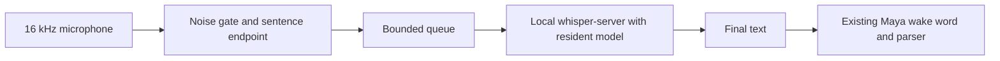

# Local whisper.cpp bridge

Selecting `STT_ENGINE=whisper.cpp` in settings uses `WhisperVoice`, preserving the text callback received by `App`. `STT_ENGINE=vosk` restores the previous backend. Kokoro output with `af_heart` is independent of this setting.

The server is a Maya child process bound only to `127.0.0.1` on a dynamically selected port. Mono PCM WAV is assembled in memory, sent to `/inference` and discarded after the response. Microphone audio is not saved. Code and model remain local after the initial download. `/health` confirms model readiness before capture is announced as ready. Stopping or switching the backend terminates the process owned by that instance.

Whisper transcribes complete sentences; this integration does not provide partial word-by-word text. Capture continues on its thread while another thread transcribes. At most one sentence waits alongside the current transcription. Segments shorter than two speech blocks are ignored; sentences are limited to 15 seconds. Names in `WHISPER_PROMPT` are vocabulary hints, not accuracy guarantees.

Capture currently uses half-duplex operation: audio is not sent for transcription while Maya speaks. This reduces recognition of its own voice but does not support voice interruption during TTS. Keyboard shortcuts and text input remain available.

## Reference installation

- Official source: `ggml-org/whisper.cpp`, tag `v1.9.5`, under `.runtime/whisper.cpp`.
- Server: `.runtime/whisper.cpp/build/bin/whisper-server`.
- Vulkan backend for the AMD GPU.
- Model: `models/whisper/ggml-small.en.bin`.
- Model SHA-256: `c6138d6d58ecc8322097e0f987c32f1be8bb0a18532a3f88f734d1bbf9c41e5d`.
- Vulkan/SPIR-V headers and glslc from signature-verified Fedora RPMs extracted locally, without system package installation.

This describes the original development machine. Rebuilding elsewhere requires C++, CMake, Ninja, Vulkan Headers, SPIRV-Headers and glslc, or a CPU-only build. Existing local binaries do not require rebuilding to run.

## Settings

`STT_ENGINE`, `WHISPER_CPP_SERVER`, `WHISPER_MODEL_PATH`, `WHISPER_THREADS`, `WHISPER_USE_GPU` and `WHISPER_PROMPT` appear under Voice. Capture must use 16000 Hz. The initial configuration used `small.en`, six threads and Vulkan.

Configure the official repository with `GGML_VULKAN=ON`, supply the local dependency prefix if necessary, and build `whisper-server` and `whisper-cli`. For CPU operation, disable `GGML_VULKAN` and set `WHISPER_USE_GPU=false`.

References: [server protocol](https://github.com/ggml-org/whisper.cpp/tree/v1.9.5/examples/server), [Vulkan support](https://github.com/ggml-org/whisper.cpp#vulkan-gpu-support), [model distribution](https://huggingface.co/ggerganov/whisper.cpp).

## Reconhecimento principal e reserva automática — 20/10/2026

A configuração local atual usa `ggml-large-v3-turbo-q5_0.bin` no Whisper e
`vosk-model-en-us-0.22` como reserva. O idioma permanece inglês. O arquivo do
Whisper veio da revisão `5359861c739e955e79d9a303bcbc70fb988958b1` do repositório
oficial ggerganov/whisper.cpp; SHA-256 verificado:
`394221709cd5ad1f40c46e6031ca61bce88931e6e088c188294c6d5a55ffa7e2`.

`STT_FALLBACK_ENABLED=true` ativa `FailoverVoice`. A reserva carrega só após uma
falha de disponibilidade, carregamento, captura ou transcrição do principal.
Primeiro para e aguarda a captura anterior; se não conseguir encerrá-la, não abre
outra. Resultados atrasados do motor com erro são bloqueados. A frase perdida na
falha não é repetida automaticamente: é necessário dizer novamente, evitando
executar comandos antigos. Se ambos falharem, informa erro, sem ciclo infinito.
Parar/reiniciar reconhecimento ou reaplicar configurações tenta o Whisper novamente.

O Vosk de reserva respeita a pausa durante TTS. No endpoint rápido, o Vosk agora
consulta `FinalResult()` antes de entregar a frase, aproveitando a revisão final
em vez de usar diretamente o texto provisório de `PartialResult()`.

A reserva pode consumir bastante RAM: o teste isolado do modelo grande chegou a
aproximadamente 7,1 GiB de pico do processo. Não mantém os dois reconhecedores
carregados em paralelo por projeto. Os modelos pequenos continuam instalados.
O pacote Vosk foi baixado do catálogo oficial por HTTPS, teve CRC do ZIP validado
e SHA-256 registrado localmente; o hash não foi comparado com um checksum publicado.

Validação: áudios sintéticos no Whisper real; Vosk real; falha provocada do processo
Whisper durante captura sintética, seguida de transcrição no Vosk, verificando
uma captura simultânea no máximo. Esses testes não abriram o microfone físico.
“status da voz” mostra motor selecionado, motor em uso, estado e reserva habilitada.

O microfone desativado na configuração do usuário foi preservado. O backup privado
anterior à troca fica em `.runtime/vosk-upgrade/env-before-upgrade.bak`.
