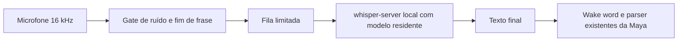

# Ponte local para whisper.cpp

A escolha `STT_ENGINE=whisper.cpp` nas settings usa `WhisperVoice`, mantendo o mesmo callback de texto recebido pelo `App`. `STT_ENGINE=vosk` restaura o backend anterior. A voz de saída Kokoro/af_heart é independente dessa escolha.

O servidor é um processo filho da Maya ligado somente a `127.0.0.1`, em porta escolhida dinamicamente. WAV mono PCM é montado na memória, enviado a `/inference` e descartado depois da resposta. O áudio do microfone não é salvo. Modelo e código são locais após o download inicial. `/health` confirma que o modelo carregou antes da captura ser anunciada como pronta. Parar/trocar o backend encerra o processo pertencente à instância.

O Whisper transcreve frases completas; esta integração não fornece texto parcial palavra a palavra. A captura continua em sua thread enquanto outra transcreve. Há no máximo uma frase aguardando, além da que estiver sendo processada. Trechos menores que dois blocos de fala são ignorados e frases são limitadas a 15 segundos. Os nomes em `WHISPER_PROMPT` são pistas de vocabulário, não uma promessa de acerto.

Por enquanto o Whisper funciona em meia comunicação: enquanto a Maya fala, o áudio não é encaminhado para transcrição. Isso reduz o reconhecimento da própria voz, mas não oferece interrupção por voz durante TTS. Atalho e interface de texto continuam disponíveis.

## Instalação desta máquina

- fonte oficial `ggml-org/whisper.cpp`, tag `v1.9.5`, em `.runtime/whisper.cpp`;
- binário `.runtime/whisper.cpp/build/bin/whisper-server`;
- backend Vulkan compilado para usar a GPU AMD;
- modelo `models/whisper/ggml-small.en.bin`;
- SHA-256 do modelo: `c6138d6d58ecc8322097e0f987c32f1be8bb0a18532a3f88f734d1bbf9c41e5d`;
- headers Vulkan/SPIR-V e compilador glslc de RPMs Fedora com assinaturas verificadas, extraídos em pasta local; sem instalação de pacotes no sistema.

As dependências de desenvolvimento extraídas estão no diretório de trabalho desta conversa. Uma recompilação em outra máquina precisa de compilador C++, CMake, Ninja, Vulkan Headers, SPIRV-Headers e glslc, ou um build somente CPU. Não é necessário recompilar para executar os binários locais já produzidos.

## Settings

`STT_ENGINE`, `WHISPER_CPP_SERVER`, `WHISPER_MODEL_PATH`, `WHISPER_THREADS`, `WHISPER_USE_GPU` e `WHISPER_PROMPT` ficam na categoria Voice. A captura deve ser 16000 Hz. O experimento inicial usa `small.en`, seis threads e Vulkan.

Para reproduzir o build com as dependências já disponíveis, rode CMake no repositório oficial com `GGML_VULKAN=ON`, informe o prefixo local das dependências se necessário, e compile os targets `whisper-server` e `whisper-cli`. Para CPU, desative `GGML_VULKAN` e configure `WHISPER_USE_GPU=false`.

Fontes: [servidor e protocolo](https://github.com/ggml-org/whisper.cpp/tree/v1.9.5/examples/server), [suporte Vulkan](https://github.com/ggml-org/whisper.cpp#vulkan-gpu-support), [distribuição de modelos](https://huggingface.co/ggerganov/whisper.cpp).
